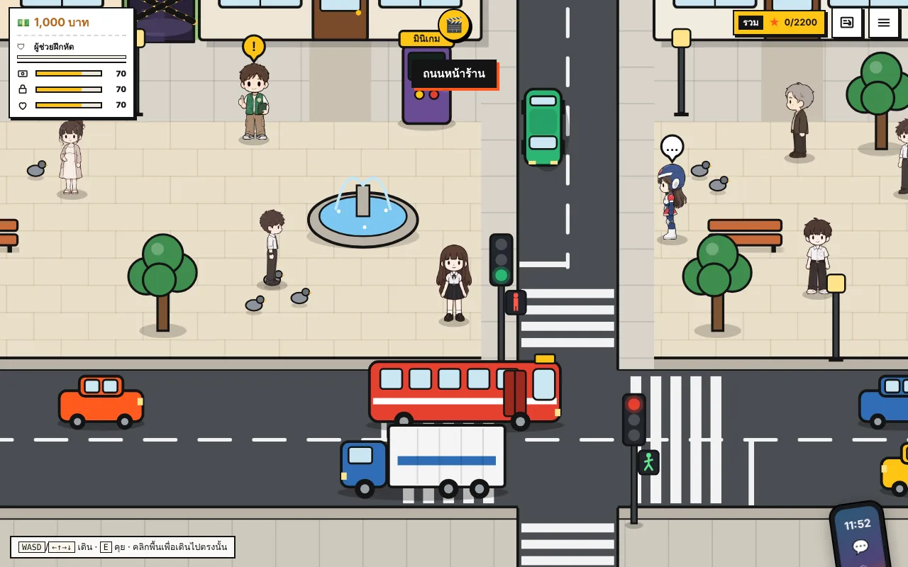
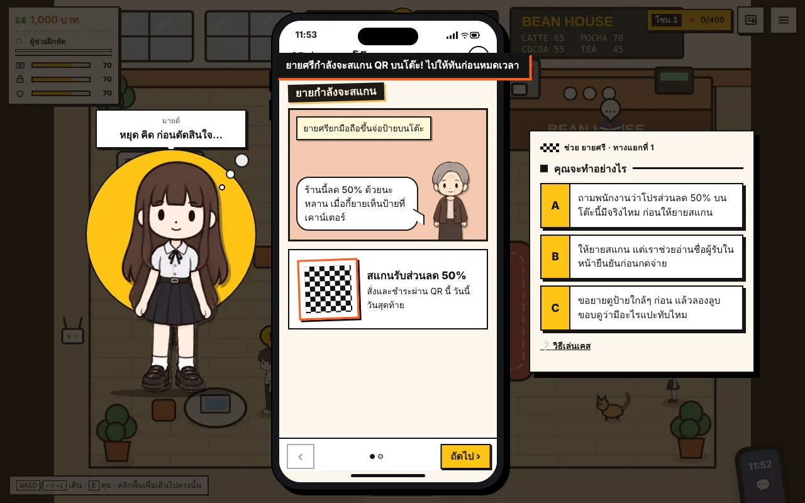
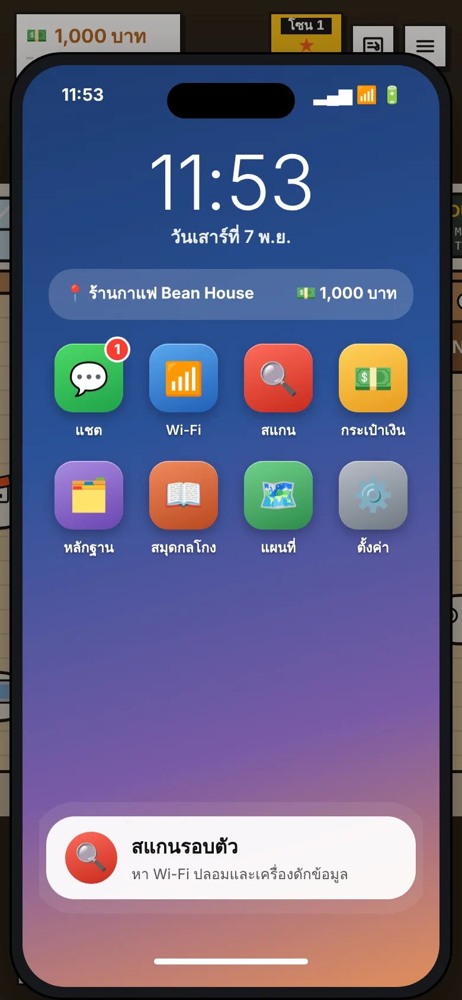
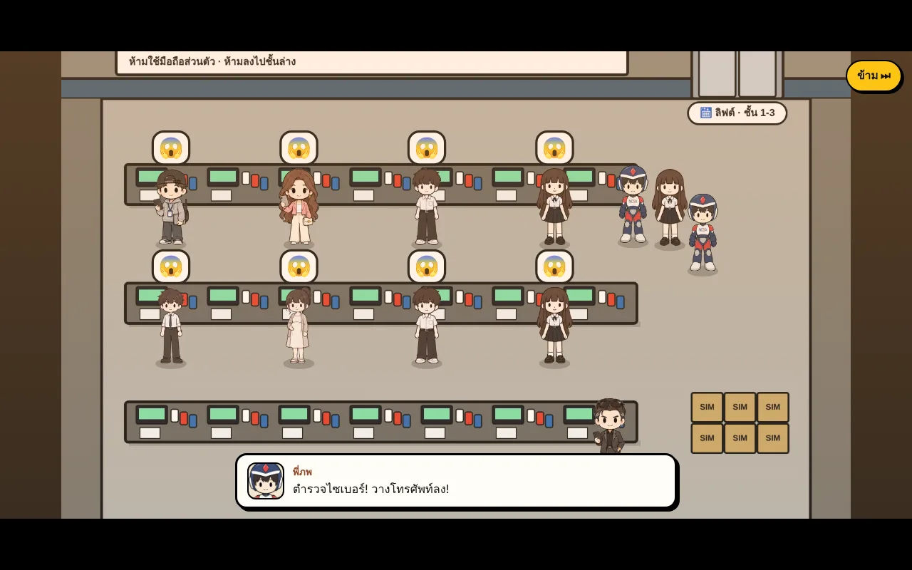

# Cyber Mission · ภารกิจรู้ทันไซเบอร์

เกมสอนความปลอดภัยไซเบอร์แบบเดินสำรวจ (top-down) เล่นบนเบราว์เซอร์ได้ทั้งคอมและมือถือ รองรับภาษาไทยและอังกฤษ

ผู้เล่นมาสืบแก๊งมิจฉาชีพ "แก๊งเงา" ที่ระบาดอยู่แถวนี้ เดินช่วยคนในร้านกาแฟ ห้องสมุด ธนาคาร ร้านเน็ต และมหาวิทยาลัย ไม่ให้โดนหลอก เก็บหลักฐาน หาตึกที่แก๊งซ่อนอยู่ แล้วไปบุกพร้อมตำรวจ ตอนจบมีให้ 5 แบบ ขึ้นอยู่กับว่าช่วยคนได้ดีแค่ไหน

> **เล่นเลย:** https://polypiku.github.io/cyber-mission/ (ใช้ได้หลังเปิด GitHub Pages)



| เคสในมือถือ | หน้าโฮมมือถือ | คัทซีนบุกรังแก๊ง |
|---|---|---|
|  |  |  |

## สิ่งที่อยู่ในเกม

- **22 เคส ไม่ซ้ำกัน**: QR ปลอม, Wi-Fi ปลอม, แก๊งคอลเซ็นเตอร์, วิดีโอคอลตำรวจปลอม, แอปดูดเงิน, ตู้ชาร์จขโมยข้อมูล, ชวนลงทุน, งานออนไลน์ปลอม, แรนซัมแวร์ ฯลฯ ทุกตัวเลือกมีผลต่อเรื่องและคะแนน
- **คนร้ายแฝงตัวในฝูงคน**: แฮกเกอร์ Wi-Fi นั่งปนกับลูกค้าทั่วไป ถ้าปล่อยไว้นาน มือถือจะค่อยๆ กระตุกจนติดไวรัส ต้องรีบไปร้านซ่อมภายใน 30 วินาที
- **มือถือในเกม**: หน้าโฮม แอปแชต Wi-Fi กระเป๋าเงิน และปุ่มสแกนหา Wi-Fi ปลอม
- **เมืองที่เดินได้**: สี่แยกมีไฟจราจรและทางม้าลาย, ห้องสมุด 2 ชั้น, ตึกออฟฟิศ 3 ตึก (สุ่มทุกเกมว่าตึกไหนเป็นรังแก๊ง), สถานีตำรวจกับห้องขัง 10 ห้อง
- **เนื้อเรื่องและฉากจบ 5 แบบ**: คัทซีนที่ตัวละครเดินเอง พร้อมภาพสรุปแบบการ์ตูนช่อง
- **เงินเป็นบาท** และร้านอัปเกรด, เสียงสังเคราะห์สดไม่ใช้ไฟล์เสียง, บันทึกความคืบหน้าไว้ในเบราว์เซอร์

## เล่นบนเครื่องตัวเอง

ไม่ต้องติดตั้งอะไร แค่เปิดเว็บเซิร์ฟเวอร์เล็กๆ ในโฟลเดอร์นี้

```bash
python3 -m http.server 8000
# แล้วเปิด http://localhost:8000
```

หรือใช้ส่วนเสริม Live Server ใน VS Code ก็ได้

ถ้าอยากได้ไฟล์เดียวที่ดับเบิลคลิกเปิดได้ทันที:

```bash
python3 tools/build_single.py     # ได้ไฟล์ dist/cyber-mission.html
```

## โครงสร้างโปรเจกต์

```
index.html            หน้าเกม + ลำดับการโหลดสคริปต์
css/style.css         หน้าตาทั้งหมด (HUD, มือถือ, การ์ด, คัทซีน)
js/
  core.js             เซฟ เสียง ตัวละคร โซน คะแนน หลักฐาน
  world.js            แผนที่ ห้อง ถนน สี่แยก ห้องสมุด 2 ชั้น
  render.js           วาดฉากบน canvas
  crowd.js            ฝูงคน แฮกเกอร์แฝงตัว ตำรวจคุมตัว ไวรัส เงิน
  story.js            บทนำ สถานีตำรวจ การบุก ฉากจบ
  engine.js           กล้อง ลูปเกม การควบคุม HUD กล่องบทพูด
  talk.js             บทพูดของแต่ละคน ทัวร์แนะนำเกม
  office.js           ตึกออฟฟิศ 3 ตึก ทั้งข้างนอกและข้างใน
  cinema.js           คัทซีนที่ตัวละครเดินเอง
  ui.js               หน้าต่างเคส การ์ตูนช่อง บทสอนเคสแรก
  phone.js            มือถือ: หน้าโฮม แชต Wi-Fi สแกน
  arcade.js           มินิเกมที่ตู้ข้างถนน
  main.js             โหลดรูปแล้วเริ่มเกม
data/
  cases/              เนื้อหาเคสทั้งหมด (ไทย/อังกฤษ)
  sprites.js          รายการรูปตัวละคร
  heroes.js           รูปตัวละครที่เลือกเล่นได้
assets/               รูปตัวละครทุกท่า (WebP)
tools/
  build_single.py     รวมทุกอย่างเป็นไฟล์ HTML เดียว
  smoke_test.py       เปิดเกมอัตโนมัติแล้วเช็กว่าไม่มี error
```

เขียนด้วย HTML, CSS และ JavaScript ล้วน ไม่ใช้เฟรมเวิร์กหรือไลบรารี วาดทุกอย่างบน `<canvas>`

## ทดสอบ

```bash
pip install playwright && playwright install chromium
python3 tools/smoke_test.py
```

สคริปต์จะเปิดเกมทั้งขนาดจอคอมและจอมือถือ เดินเข้าทุกโซน เปิดมือถือ เปิดเคส แล้วรายงานว่ามี error หรือรูปโหลดไม่ขึ้นหรือเปล่า

## ผู้จัดทำ

ออกแบบเกม เนื้อเรื่อง และกำกับ: ฑิตยา คูณศรี (พริ้ง) · วิทยาการคอมพิวเตอร์ มหาวิทยาลัยหัวเฉียวเฉลิมพระเกียรติ

เขียนโค้ดร่วมกับ Claude (Anthropic)

ชื่อธนาคาร ร้านค้า บุคคล และเว็บไซต์ในเกมเป็นเรื่องสมมติทั้งหมด
